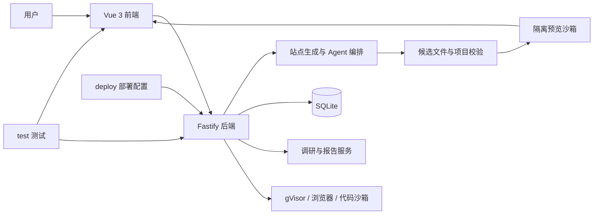
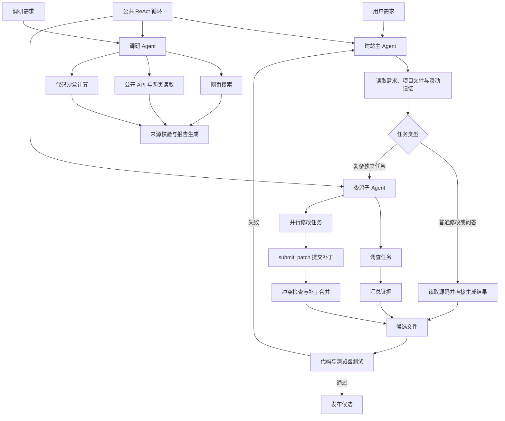

# 建站工作台

基于 Vue 3、Fastify、Node.js 和 SQLite 的对话式在线建站平台。

## 项目架构

- `src/`：Vue 3 前端工作台，包含对话、项目、预览和调研报告界面。
- `server/`：Fastify 后端与站点生成服务，包括模型调用、Agent、多 Agent 协作、预览沙箱、存储和分享预览。
- `deploy/`：Linux 部署所需的 Docker、systemd、启动器和权限配置。
- `test/`：构建、API、预览和生成流程测试。

前端负责编排用户交互和预览展示，后端负责对话生成、项目管理、文件合并、沙箱执行和访问控制。生成的站点运行在隔离预览环境中，并通过 SQLite 保存项目数据。

## Agent 架构

- **建站主 Agent**：基于 LangChain ReAct 循环读取需求和项目文件，规划任务，调用源码读取、候选保存、代码执行、浏览器测试和预览控制工具，并根据工具结果修正或发布候选。
- **子 Agent**：主 Agent 可并行委派最多 3 个互不重叠的调查或修改任务。子 Agent 使用独立预算和工作副本读取源码、提交补丁或浏览器验收；主 Agent 再通过批次合并和冲突检查生成最新候选。
- **调研 Agent**：负责网页搜索、公开 API 和数据读取、代码沙盒计算及报告生成。调研工具和报告来源受到提取、清洗与来源引用约束。
- **公共执行循环**：建站与调研 Agent 共用 `react-agent.mjs` 的工具调用循环、输出预算、结束收尾和失败纠正机制，工具调用按顺序执行以保护候选和预览状态。
- **上下文与记忆**：项目原始对话存入 SQLite；超出近期上下文的记录会分批提炼到项目滚动摘要，Agent 可按关键词或对话 ID 查询历史记录。
- **隔离执行**：前端预览运行于隔离 iframe，项目后端和浏览器测试分别运行于沙箱环境；生成文件通过项目级校验后保存为候选版本。

## 体验地址

https://aitishici.site/builder/
