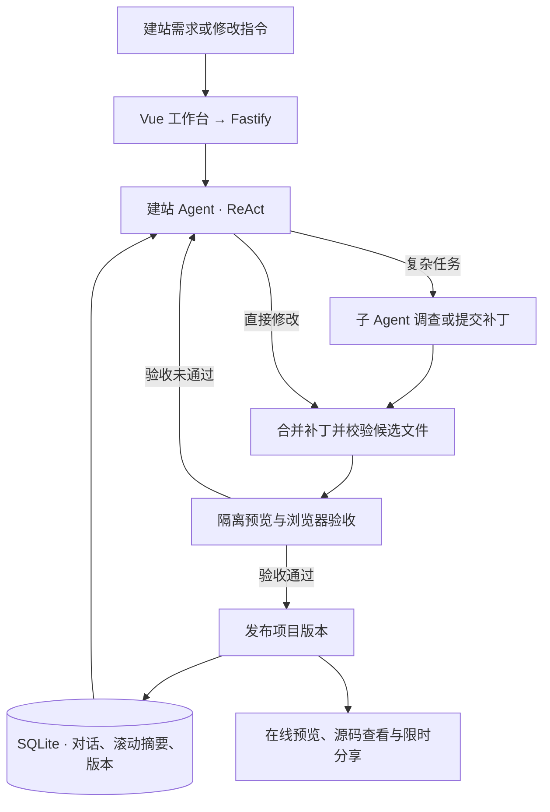
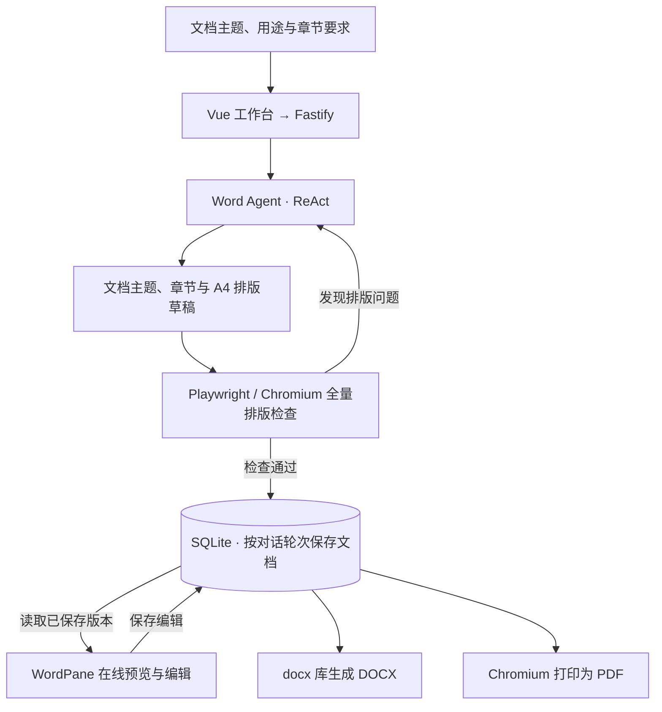
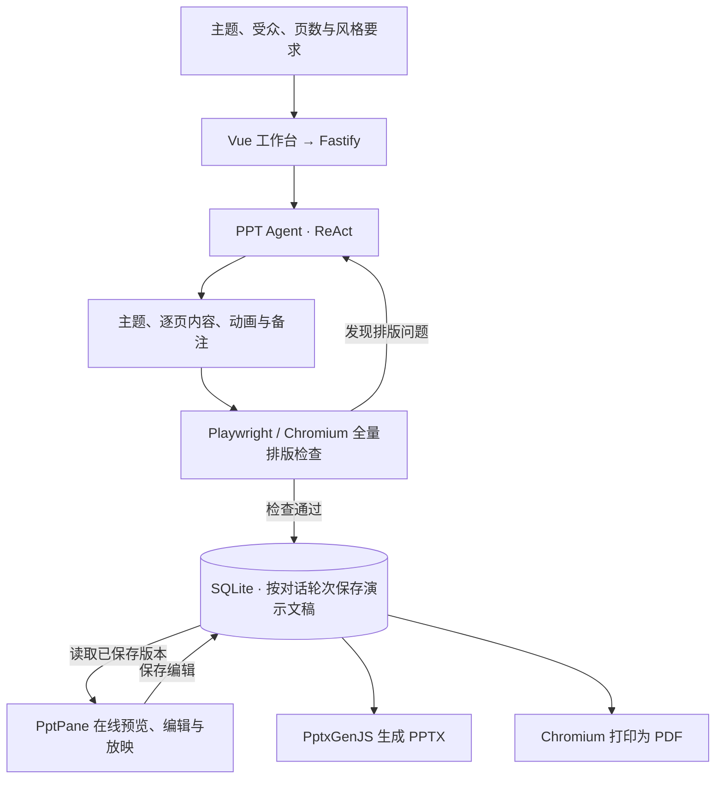
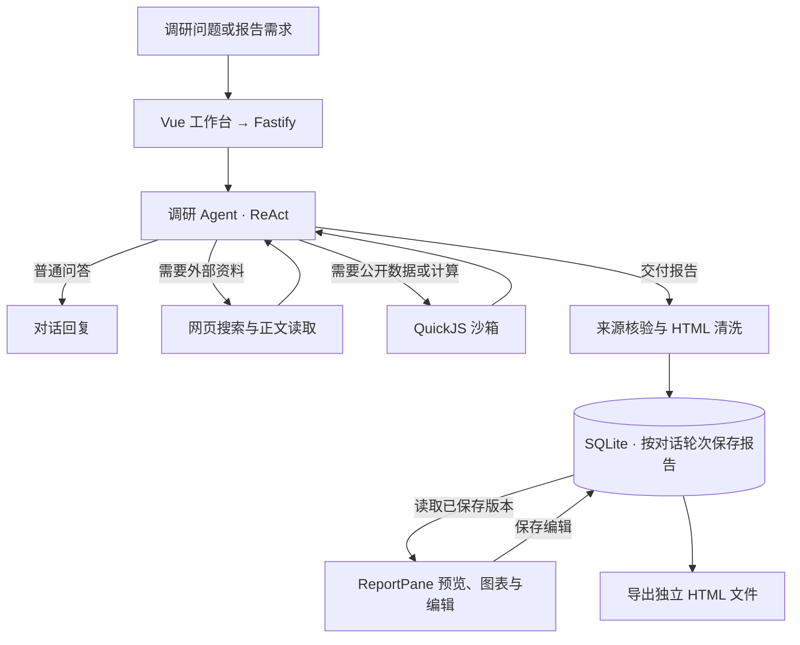

# 建站工作台

一个基于 Vue 3、Fastify、Node.js 和 SQLite 的对话式工作台。选择项目类型后，可以通过对话生成网站、Word 文档、PPT 演示文稿或调研报告，也可以继续修改已有成果。

[在线体验](https://aitishici.site/builder/)

## 功能一览

| 项目类型 | 可以做什么 | 交付方式 |
| --- | --- | --- |
| 在线建站 | 用自然语言生成或修改网站，查看源码和版本，运行交互预览和浏览器验收 | 在线预览、版本回退、限时分享链接 |
| Word 文档 | 按用途、主题和章节生成 A4 文档，在线编辑正文，可设置封面、目录和页眉页脚 | DOCX、PDF |
| PPT 演示文稿 | 按受众、主题和页数生成幻灯片，在线编辑文字、演讲备注和切页效果，支持放映 | PPTX、PDF |
| 调研报告 | 搜集公开资料，整理数据和结论，生成带来源链接的报告，支持在线编辑 | HTML |

## 在线建站

建站 Agent 读取现有源码和项目上下文，生成或更新候选版本。复杂任务可委派给最多三个并行子 Agent，主 Agent 检查并合并补丁，再执行浏览器验收。通过验收的候选成为可预览的版本，用户可查看源码、回退版本或创建 24 小时有效的分享链接。访客预览使用独立数据。



## Word 文档

描述文档用途、受众和章节结构后，Word Agent 按章节起草或修改内容，在浏览器中完成全量 A4 排版检查后交付。打开对话中的成果可预览、编辑正文并保存，再导出可继续编辑的 DOCX 或便于分发的 PDF。



## PPT 演示文稿

描述主题、受众、页数和风格后，PPT Agent 逐页编排内容，并在浏览器中检查整套幻灯片的布局。在线预览支持翻页、放映和重播动画，也可编辑文字、切页效果和演讲备注。PPTX 导出会保留演讲备注。



## 调研报告

可直接提问，也可要求围绕一个主题生成或更新报告。调研 Agent 按需搜索和读取公开网页，通过 QuickJS 沙箱获取公开数据或执行计算，在生成报告时核对引用来源并清洗 HTML。打开对话中的报告可查看图表、编辑正文，并下载保存后的 HTML。



## 项目结构与本地运行

- `src/` 包含 Vue 工作台、网站预览和三种成果的编辑面板。
- `server/` 包含 Fastify API、共享 ReAct 执行循环、四项功能的生成逻辑、存储与导出服务。
- `deploy/` 包含 Linux 部署使用的 systemd 服务、容器镜像和沙箱启动器配置。
- `test/` 包含生成流程、API、预览和调研报告测试。

需要 Node.js 24.15.0 或更高版本。将 `.env.example` 复制为 `.env` 并配置 `DEEPSEEK_API_KEY` 后运行以下命令。Word 和 PPT 的排版检查及导出需要 Chrome 或 Chromium，可通过 `PLAYWRIGHT_CHROMIUM_EXECUTABLE_PATH` 指定可执行文件。

```sh
npm ci
npm run dev
```

默认访问 `http://localhost:3000`。运行 `npm test` 执行测试，可通过 `BUILDER_TEST_CHROMIUM` 指定浏览器以启用 Chromium 集成用例。
